# Mermaid Reference (recording without draw.io)

Read this only when `render.py doctor` exits with 1: draw.io desktop is not installed, so
the version is recorded as a Mermaid block in its `.md`. With draw.io installed, a version
is always a `.drawio.svg`, and `drawio.md` is the reference.

A Mermaid version is a full version: it has a number, a status, a record and an index
row. It differs from a draw.io version in four ways:

- It is one file, `NNNN-slug.md`, with `format: mermaid` in the frontmatter and the block
  where the image goes. There is no `NNNN-slug.drawio.svg`.
- It has no product icons. A component is a labelled shape.
- Mermaid places the shapes. You choose the direction and the groups, not the positions.
- Nothing renders it here, so there is no preview to look at. Section 4 says what to read
  in the text instead, and the report says that no rendered picture was inspected.

The type's own reference (`types/<type>.md`) still says what the picture shows and what to
draw it from. Only its shapes, layout and "Check the preview" sections are for draw.io.

## 1. The block

````markdown
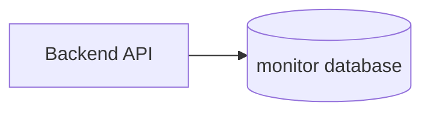
````

- One block for each record. The opening line is exactly three backticks and `mermaid`.
- The first line of the block is the keyword of the type (section 2). A `%%` comment line
  may come before it.
- Labels use the names in the glossary and the names the code uses, as in a draw.io
  version.

## 2. One example for each type

Start from the example of the type. Each one passes `check_diagrams.py`, and a test keeps
it so.

| Type | Keyword | How the notation is carried |
|---|---|---|
| `architecture` | `flowchart LR` | A boundary is a `subgraph`. Solid arrow: data. Dotted arrow: control |
| `workflow` | `flowchart TD` | A lane is a `subgraph` for each actor. Steps have numbers in the label |
| `deployment` | `flowchart TB` | A place is a `subgraph`; a place inside a place is a nested `subgraph` |
| `use-case` | `flowchart LR` | The system is a `subgraph`. An actor is a box; a use case is a rounded shape |
| `data-flow` | `flowchart LR` | A process is a circle, a store is a cylinder, an external entity is a box, a trust boundary is a `subgraph` |
| `decision` | `flowchart TD` | A question is a diamond. Each branch has its answer on the arrow |
| `sequence` | `sequenceDiagram` | `autonumber`; `->>` is a call and `-->>` is a reply |
| `state` | `stateDiagram-v2` | `[*]` is the start and the end. The trigger is on the transition |
| `er` | `erDiagram` | Every column has the constant type `col`, because the rule shows no data types |
| `class` | `classDiagram` | Attributes that identify the class, no methods |

### `architecture`

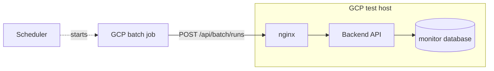

### `workflow`

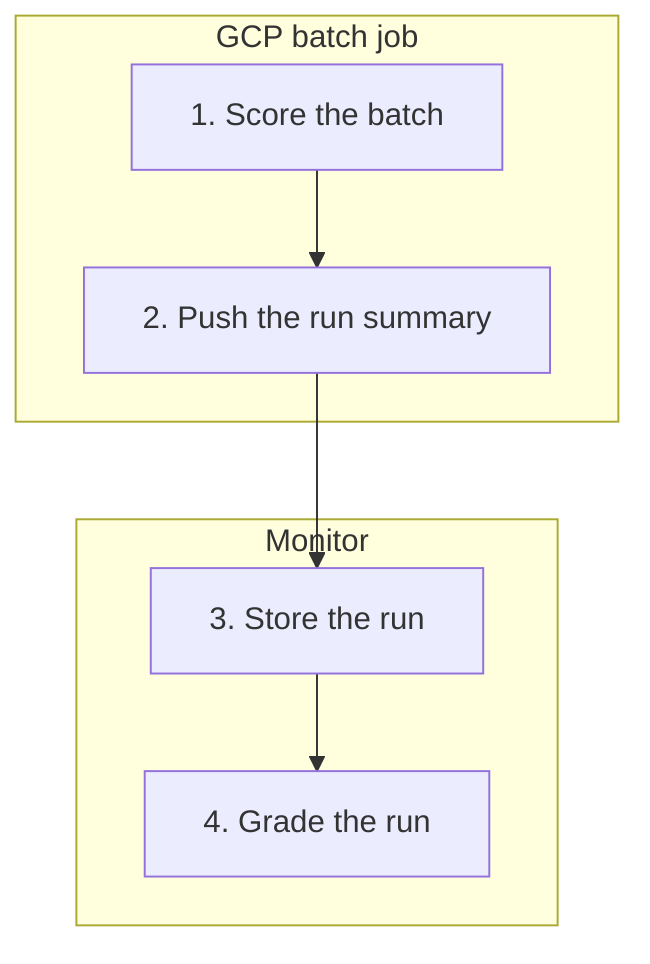

### `deployment`

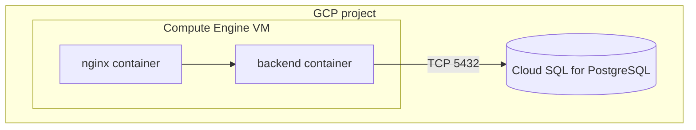

### `use-case`

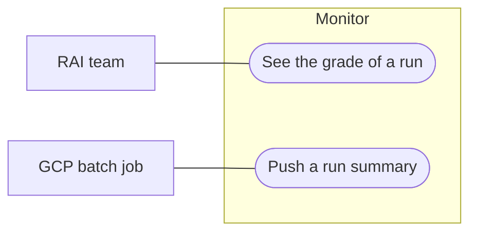

### `data-flow`

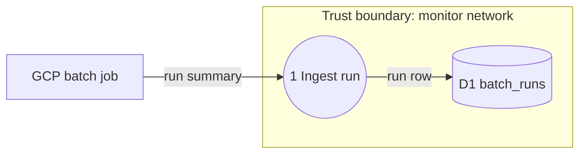

### `decision`

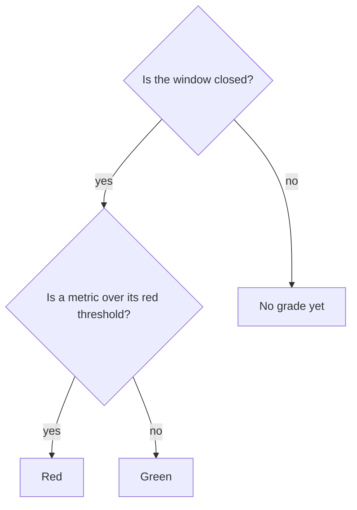

### `sequence`

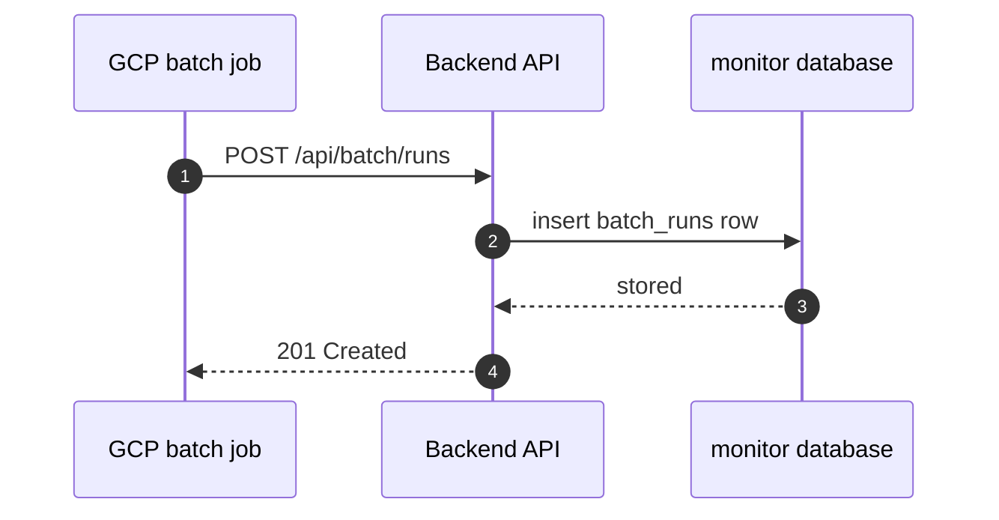

### `state`

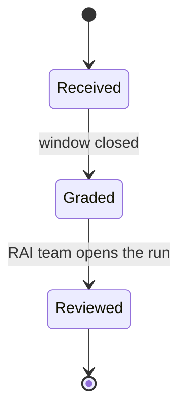

### `er`

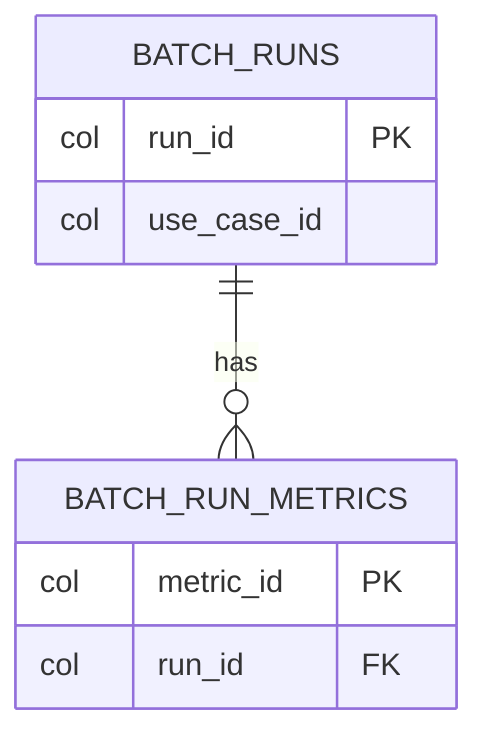

### `class`

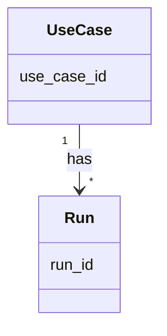

## 3. What the check refuses

`check_diagrams.py` refuses these in a Mermaid version, for the reason a draw.io version
embeds every image: the picture must not depend on anything outside its file.

| Refused | Use |
|---|---|
| A `%%{` directive, or a `---` configuration block before the keyword | GitHub's default look |
| `click` and `href` | No links in a picture. Put a link in the record's text |
| A URL (`http://`, `https://`, `www.`) | The name of the system, not its address |
| The tags `img`, `a`, `script`, `iframe`, `object`, `embed`, `style` | `<br/>` for a line break, and no other tag |
| A second `mermaid` block in the record | One version is one picture |
| A keyword that is not the keyword of the type | The table in section 2 |
| `architecture-beta` and other new syntaxes | `flowchart`; GitHub may not draw a new syntax yet |

## 4. Read the text, because there is no preview

The check proves the structure, not that the block renders. Before you write the record,
read the block once for each line below.

- **Every label with punctuation is in double quotes**: `api["POST /runs (v1)"]`. An
  unquoted bracket, parenthesis, colon or slash can end the label early.
- **No node is named `end`**, and no id starts with `o` or `x` right after an arrow
  (`a---ob` draws a circle end). Put a space on each side of an arrow.
- **Every `subgraph` has its `end`**, and every `alt`, `opt`, `loop` and `par` in a
  sequence has its `end`.
- **Every id that an arrow uses is declared**, or its label is the id itself. A typing
  mistake in an id makes a new, empty node.
- **The text has no `](`**: the repository's link test reads it as a Markdown link.
- **No IP address, token or internal URL**, as in every diagram.
- Then the points of the type:

| Type | Read for |
|---|---|
| `architecture` | Each component is in its boundary; each flow has a direction and a label where the type's reference asks for one |
| `workflow` | Each step is in its actor's lane; the numbers run in order |
| `deployment` | Each artifact is inside the place where it runs; each path names its protocol or port |
| `use-case` | Each use case is inside the system; each actor is outside it |
| `data-flow` | Each flow has a data name; no flow joins two stores directly; each store is inside its trust boundary |
| `decision` | Each question has an answer on every branch; each path ends in an outcome |
| `sequence` | Each call that has a reply shows it; the order is the order in the code |
| `state` | A start exists; each transition has its trigger; no state is unreachable |
| `er` | Each table has its key; each `FK` column has its relationship line; the cardinality marks are on the correct sides |
| `class` | Each relation has its multiplicity; no methods |

The first rendered view is the record on GitHub after a push. Open it there, and correct
a mistake in the block in place.

## 5. When draw.io is available later

A Mermaid version is not drawn again only to change its format: the rule records nothing
when the picture does not change. The next version that is due is a draw.io version, and
it starts from the type's example in `assets/examples/`, because a Mermaid block has no
layout to keep. On request, a person can ask for the draw.io drawing early: it is a new
number, and its record says "Same content as NNNN, drawn in draw.io".
