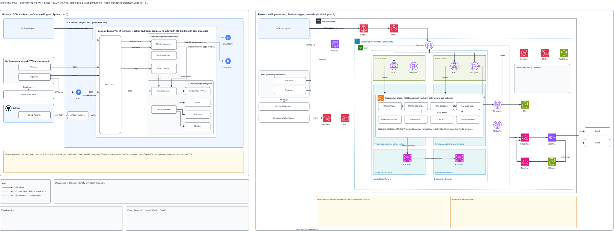

# Architecture 0001: phase 1 (GCP test host) and phase 2 (AWS production)

## What it shows

The batch monitoring MVP in its two phases, side by side. Phase 1 is the test host for
Sprints 1 to 3: one Compute Engine VM in GCP with Docker Compose, on a private VPC path.
Phase 2 is production in Sprint 4: the AWS Kubernetes cluster in the Thailand region, with
two availability zones (plan A). Each phase shows who connects, the front door and its
routes, the components, the stores, and the ports and protections between them.

The picture leaves out the content of a run summary (the JSON body), the grading logic, the
prototype code that is not mounted, and the local stack. It contains no IP address, token or
internal URL.

## What changed since the previous version

First recorded version. It starts from the two hand-drawn drafts of S3-08a in
[`docs/architecture/`](../../architecture/README.md) and differs from them as follows.

Phase 1, corrected to agree with the plan and the deploy files:

| The draft said | This version says | Source |
|---|---|---|
| Jobs use HTTPS 443 with a private CA certificate | Plain HTTP on port 80, on the private VPC path | S1-04, decided 2026-10-08 |
| Dashboard on 8443, Langfuse on 3443 | Dashboard on 8080, Langfuse on 3000 | Sprint 2 prerequisites |
| Engineers reach Langfuse from the staff network | Langfuse only through the IAP tunnel to port 3000 | S2-03, `deploy/nginx` |
| OAuth2 Proxy and SSO on the test host | No dashboard SSO on the test host. Langfuse has Google sign-in. | S3-07, S2-03 |
| Cloud DNS private zone | No DNS name on the test host | S1-04 |
| VM `e2-standard-8`, Ubuntu 24.04, 200 GiB | `n4-highmem-4`, Debian 12, 100 GB | S1-04 |
| One Cloud SQL instance holds `monitor` and `langfuse` | Cloud SQL holds only `monitor`. Langfuse has its own PostgreSQL 17.11 container. | S2-03, `deploy/langfuse` |

Phase 1, added: the Compose projects `model-monitor` and `langfuse` and the `edge` network;
the trace check tool; the two outputs of the Collector; the routes of the front door.

Phase 2, added: the ingress routes; the flow from the backend to Langfuse; the path of the
jobs through Cloud NAT; plan B; the fallback without a DNS name. Kept and marked for the
consultation: one RDS instance holds both databases (plan A in S3-06 has one instance for
each).

Both phases, added: the data scope (identity-only, no judge), the fixed versions, and the
change from phase 1 to phase 2.

## Built and not built

The status is `proposed` because the picture shows an end state.

| Part | State on 2026-10-13 |
|---|---|
| Phase 1: front door, backend batch API, Collector, trace check tool, Cloud SQL | Built and on the test host |
| Phase 1: Langfuse and its four stores | Built (`deploy/langfuse`, S2-03). Not yet installed on the test host. |
| Phase 1: dashboard on port 8080 | Not built (S2-07) |
| Phase 1: backend spans and scores to Langfuse | Not built (S2-05) |
| Phase 2: all of it | Not built (S3-06, S3-07, S4-01). The Kubernetes files do not exist yet. |

## Key

| Mark | Means |
|---|---|
| Solid dark arrow | Data flow |
| Dashed pink arrow | Control: login, SSH, operator access |
| Dotted grey arrow | Deployment or configuration: images, secrets |
| Yellow box | A decision, an exception or an assumption to examine |
| Grey box | Facts that apply to the picture: scope, versions, routes |

## Sources

- `changes/2026-10-02-batch-monitoring-mvp/plan.md` (decisions, glossary)
- `changes/2026-10-02-batch-monitoring-mvp/issues.md`: the changes of 2026-10-09, the fixed
  versions, S1-04, the Sprint 2 prerequisites, S2-03, S3-06, S3-07, S4-01, S4-02
- `changes/2026-10-12-s2-03-langfuse/spec.md`
- `deploy/compose/`, `deploy/nginx/`, `deploy/langfuse/`
- `docs/adr/0002-batch-push-ingest.md`
- The two drafts: `docs/architecture/architecture-gcp-compute-engine.drawio.svg` and
  `docs/architecture/architecture-aws-production-detail.drawio.svg`
- The recheck of S3-08a (issue #81) and the sub-issue S3-08b (#85)
