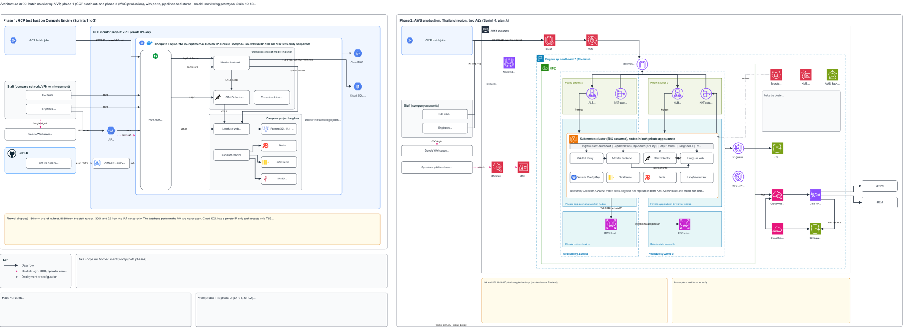

# Architecture 0002: phase 1 (GCP test host) and phase 2 (AWS production), with ports, pipelines and stores

## What it shows

The batch monitoring MVP in its two phases, side by side, as in version 0001, with more
detail. Phase 1 is the test host for Sprints 1 to 3: one Compute Engine VM in GCP with three
Docker Compose projects, on a private VPC path. Phase 2 is production in Sprint 4: the AWS
Kubernetes cluster in the Thailand region, with two availability zones (plan A).

The picture leaves out the content of a run summary, the grading logic, the prototype code
that is not mounted, and the local stack. It contains no IP address, token or internal URL.

## What changed since the previous version

Phase 1, added:

- The container ports: the backend on 8000, the Collector on 4319 (with the token, for the
  jobs) and on 4318 (inside, for the backend), nginx on host port 80.
- The flow of the backend spans to the Collector (OTLP 4318). Version 0001 did not show it.
- The registry file in the backend image, and the database accounts of Cloud SQL
  (`monitor_backend`, `monitor_readonly`, `dev_*`).
- The named volumes and the host secret files (names only).
- The trace check tool is now beside the Collector, so the Compose project
  `model-monitor` is wider. The other positions do not change.

Phase 2, added:

- The ingress rules as a strip in the cluster, with one edge to each service. Version 0001
  had them only in a note.
- The ConfigMap for the dashboard allowlist, with the Kubernetes secrets.

Both phases, added: the product icons of nginx, the OpenTelemetry Collector, PostgreSQL,
Redis, ClickHouse, MinIO, Docker, Kubernetes, Cloud Run, Compute Engine and Artifact
Registry. A component with no icon that a licence allows (Langfuse, OAuth2 Proxy, Google
Workspace) or with no product (the monitor backend, the trace check tool) stays a box.

Nothing was removed.

## Built and not built

The status is `proposed` because the picture shows an end state.

| Part | State on 2026-10-13 |
|---|---|
| Phase 1: front door, backend batch API, Collector, trace check tool, Cloud SQL | Built and on the test host |
| Phase 1: Langfuse and its four stores; the Collector export to Langfuse | Built (`deploy/langfuse`, S2-03). Not yet installed on the test host. |
| Phase 1: dashboard on port 8080 | Not built (S2-07) |
| Phase 1: backend spans and scores to Langfuse through the Langfuse SDK | Not built (S2-05). The backend spans go to the Collector today. |
| Phase 2: all of it | Not built (S3-06, S3-07, S4-01). The Kubernetes files do not exist yet. |

## Key

| Mark | Means |
|---|---|
| Solid dark arrow | Data flow |
| Dashed pink arrow | Control: login, SSH, operator access |
| Dotted grey arrow | Deployment or configuration: images, secrets |
| Yellow box | A decision, an exception or an assumption to examine |
| Grey box | Facts that apply to the picture: scope, versions, routes |

## Sources

- `changes/2026-10-02-batch-monitoring-mvp/plan.md` and `issues.md`: the changes of 2026-10-09, the fixed versions, S1-04, S1-11, the Sprint 2 prerequisites, S2-03, S3-06, S3-07, S4-01, S4-02
- `deploy/compose/`, `deploy/nginx/`, `deploy/langfuse/`, `deploy/sql/s1-11/`
- `docs/adr/0002-batch-push-ingest.md`
- Version 0001 and the two drafts in `docs/architecture/`
