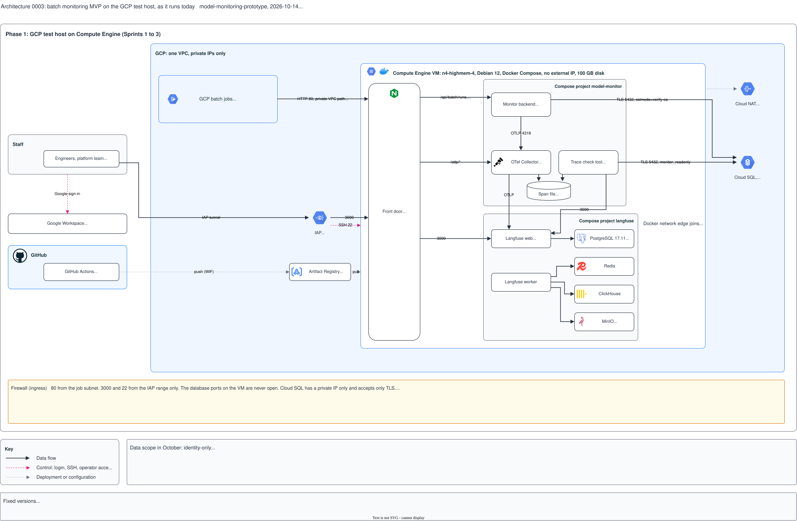

# Architecture 0003: the GCP test host (phase 1), as it runs today

## What it shows

The batch monitoring MVP on the GCP test host as it runs on 2026-10-14: one Compute Engine
VM with three Docker Compose projects (`nginx`, `model-monitor`, `langfuse`), Cloud SQL,
and the GCP batch jobs in the same VPC. It shows who connects, the front door and its
routes, the components, the stores, and the ports between them.

The picture leaves out AWS production (architecture 0004), the content of a run summary,
the grading logic, the prototype code that is not mounted, and the local stack. It contains
no IP address, token or internal URL.

## What changed since the previous version

Version 0002 showed both phases in one picture, as a proposal. This version shows only
phase 1, and only what runs on the test host. Phase 2 is now architecture 0004.

Removed, because it is not on the test host:

| Removed | Why |
|---|---|
| The staff dashboard, host port 8080, its firewall rule, and the RAI team | Not built (S2-07) |
| The backend's spans and scores to Langfuse | Not built (S2-05). The backend sends its spans to the Collector. |
| Daily disk snapshots | Planned in S1-04; no record that they run |

Port 8080 still appears once: nginx listens on 8080 inside its container, because the
unprivileged image cannot bind a port below 1024, and the host maps port 80 to it. The
planned dashboard port 8080 on the host is a different port and is not drawn.

Corrected or added against the repository:

| Version 0002 | This version | Source |
|---|---|---|
| Trace check tool with no flows | Reads Cloud SQL as `monitor_readonly` (TLS 5432), the span file, and Langfuse web on 3000 | `deploy/compose/compose.yaml`, `compose.testhost.yaml` |
| The span file only in the Collector's label | A store: the span file on the volume `collector-data`, mounted read-only by the trace check tool | `deploy/compose/compose.yaml` |
| GCP batch jobs outside the VPC | Inside the same VPC as the VM | `DEVLOG.md` (S1-04, 2026-10-08) |
| Volumes without `clickhouse-logs` | All five volumes; `collector-init` sets the owner of `collector-data` | `deploy/langfuse/compose.yaml` |
| Cloud SQL accounts `monitor_backend`, `monitor_readonly`, `dev_*` | Also `postgres` and the group `monitor_read` | `DEVLOG.md` (S1-11) |
| Python 3.12.15 (backend) | `python:3.12-slim` | `backend/Dockerfile` |
| Secrets: four host files | Also the S1-11 password files | `deploy/sql/s1-11/` |
| GCP batch jobs: 7 use cases | 1 of 7 registered (`rtr-fraud-validation`); no real run yet | `backend/registry/batch-use-cases.yaml`, `DEVLOG.md` |

Langfuse, its four stores, nginx on host port 3000, and the Collector's export to Langfuse
are drawn as running: S2-03 is installed on the test host (reported by the project team on
2026-10-14; `DEVLOG.md` records it in the entry of that day).

## Key

| Mark | Means |
|---|---|
| Solid dark arrow | Data flow |
| Dashed pink arrow | Control: login, SSH, operator access |
| Dotted grey arrow | Deployment or configuration: images |
| Yellow box | Firewall, test-host decisions, and what is not on the test host yet |
| Grey box | Facts that apply to the picture: scope, versions |

## Sources

- `deploy/compose/` (`compose.yaml`, `compose.testhost.yaml`), `deploy/nginx/`
  (`compose.testhost.yaml`, `conf.d/`), `deploy/langfuse/compose.yaml`, `deploy/sql/s1-11/`
- `backend/Dockerfile`, `backend/registry/batch-use-cases.yaml`
- `DEVLOG.md`: S1-04, S1-06, S1-11, S2-03 and the test-host entries
- `changes/2026-10-02-batch-monitoring-mvp/issues.md`: S1-04 (the VM, the network, the
  firewall), the Sprint 2 prerequisites, S2-03
- `docs/adr/0002-batch-push-ingest.md`
- Version 0002
