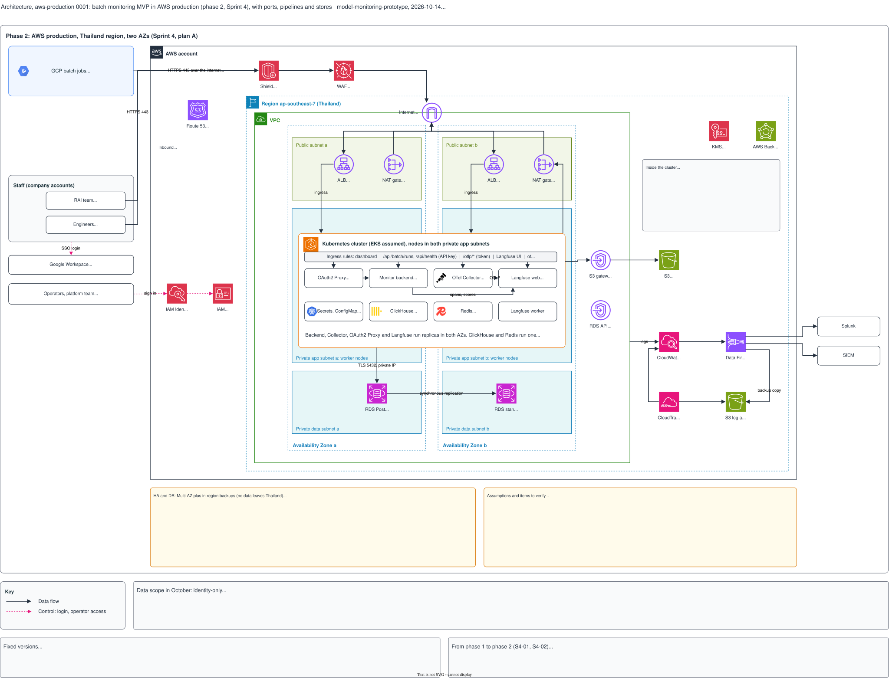

# Architecture, aws-production 0001: AWS production (phase 2), with ports, pipelines and stores

## What it shows

The batch monitoring MVP in production in Sprint 4: the AWS Kubernetes cluster in the
Thailand region, with two availability zones (plan A of S3-06). It shows the GCP batch
jobs that send to it over the internet, the staff and operators who connect, the edge
services, the cluster and its services, the stores, logging, and the change from phase 1.

The picture leaves out the GCP test host ([`gcp-test-host`](../gcp-test-host/README.md)), the content of a run
summary, the grading logic, and the local stack. It contains no IP address, token or
internal URL.

## What changed since the previous version

First version of this subject. Before it, `gcp-test-host` 0002 showed both phases in one
picture. This version is phase 2 of that picture on its own; the GCP test host as it runs
today is `gcp-test-host` 0003.

| `gcp-test-host` 0002 | This version | Source |
|---|---|---|
| Secrets Manager in the region, with a "secrets" edge to the cluster | Removed. The secrets are in the Kubernetes secret store, as the plan says; item 4 of the assumptions says so. The AWS deployment diagram already drew it this way. | `issues.md` S3-06 (decisions, acceptance criteria) |
| "Fixed versions" for both phases | Only the phase 2 versions; the backend image is `python:3.12-slim` | `backend/Dockerfile`, `issues.md` fixed versions |

Nothing else changed: the components, the flows and the notes are those of phase 2 of
`gcp-test-host` 0002.

## Key

| Mark | Means |
|---|---|
| Solid dark arrow | Data flow |
| Dashed pink arrow | Control: login, operator access |
| Yellow box | A decision, an exception or an assumption to examine |
| Grey box | Facts that apply to the picture: scope, versions, the change from phase 1 |

## Sources

- `changes/2026-10-02-batch-monitoring-mvp/plan.md` (decisions, glossary)
- `changes/2026-10-02-batch-monitoring-mvp/issues.md`: the changes of 2026-10-09, the fixed
  versions, S3-06, S3-07, S4-01, S4-02
- `docs/adr/0002-batch-push-ingest.md`
- `gcp-test-host` 0002 and the AWS draft in `docs/architecture/`
