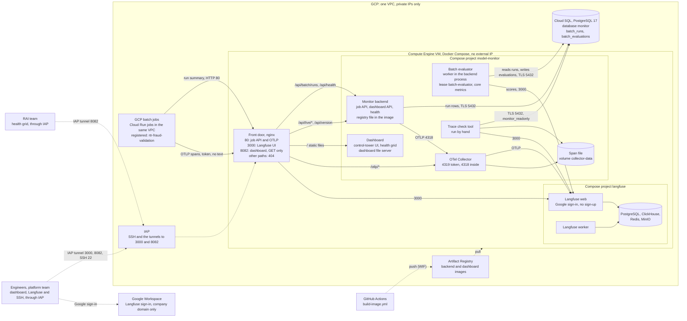

# Architecture, gcp-test-host 0004: the GCP test host with the dashboard and the evaluator

## What it shows

The batch monitoring MVP on the GCP test host as it runs on 2026-10-14: one Compute Engine
VM with three Docker Compose projects (`nginx`, `model-monitor`, `langfuse`), Cloud SQL,
and the GCP batch jobs in the same VPC. It shows who connects, the front door and its
ports, the components, the stores, and the flows between them.

The picture leaves out AWS production ([`aws-production`](../aws-production/README.md)),
the content of a run summary, the grading rules (the decision `run-grade`), the prototype
code that is not mounted, the local stack, the volumes and the account names. It contains
no IP address, token or internal URL.

## What changed since the previous version

Version 0003 listed the dashboard and the evaluator as "not on the test host yet". Both
are now deployed (`backend:16`, `dashboard:16`, 2026-10-14).

| Version 0003 | This version | Source |
|---|---|---|
| — | **RAI team**: opens the health grid through an IAP tunnel to 8082 | S2-07; `TESTHOST.md` "Dashboard (S2-07)" |
| Front door: 80 and 3000 | Also **8082**: the dashboard (GET only); `/` to the dashboard, `/api/live/*` and `/api/version` to the backend | `deploy/nginx/conf.d/dashboard.conf` |
| — | **Dashboard**: the unchanged control-tower UI (tab "Health grid"), served by the dashboard file server | `deploy/dashboard/`, `artifacts/control-tower` |
| Monitor backend: batch API and health | Also the **dashboard API** (read-only) | `backend/app/api/dashboard_routes.py` |
| — | **Batch evaluator**: grades each stored run, writes `batch_evaluations`, sends the scores to Langfuse | `backend/app/batch_evaluator.py` (S2-05) |
| Cloud SQL: database monitor | Names the two batch tables, `batch_runs` and `batch_evaluations` | `backend/app/db.py` |
| Artifact Registry: backend image | Backend and dashboard images | `.github/workflows/build-image.yml` |
| Firewall: 3000 and 22 from IAP | 3000, 8082 and 22 from the IAP range only (in the IAP node's label) | firewall `langfuse-testhost-allow-iap` |

Notes of 0003 that are not in the block (a Mermaid version has no free notes) stay true:
the identity-only data scope (records: []), no DNS name and no HTTPS on the test host, the
fixed versions, and that the stores publish no port.

Recorded as a Mermaid version: draw.io desktop is not installed on the machine that
recorded it. It has no product icons and no image file.

## Key

| Mark | Means |
|---|---|
| Solid arrow | Data flow |
| Dotted arrow | Control or deployment: access, sign-in, images |
| Cylinder | A store |
| Group | A boundary: the VPC, the VM, a Compose project |

## Sources

- `deploy/compose/`, `deploy/nginx/` (with `conf.d/dashboard.conf`), `deploy/dashboard/`,
  `deploy/langfuse/compose.yaml`
- `backend/app/main.py`, `api/dashboard_routes.py`, `batch_evaluator.py`,
  `adapters/langfuse_scores.py`, `db.py`
- `artifacts/control-tower/src/components/ChromeLive.tsx` (tab "Health grid")
- `.github/workflows/build-image.yml`
- `changes/2026-10-14-s2-05-batch-evaluator/`, `changes/2026-10-14-s2-07-dashboard/`
- `deploy/compose/TESTHOST.md`; `DEVLOG.md`, 2026-10-14
- `docs/adr/0002-batch-push-ingest.md`
- Version 0003
