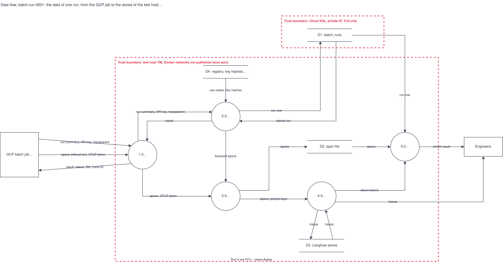

# Data flow, batch-run 0001: the data of one run, from the GCP job to the stores

## What it shows

A data flow diagram of one batch run on the test host. The GCP batch job sends a run
summary and its spans. Five processes handle them: the front door, the ingest, the
Collector, Langfuse and the trace check tool. Four stores hold the result. Two trust
boundaries are drawn: the test host VM and the Cloud SQL instance.

In October the run summary is identity-only: `schema_version`, `use_case_id`, `run_id`,
`status`, `submitted_at`, `completed_at`, `request_count`, `failed_count`, `model`, the
sample method and size, `records: []` and `records_reason`. The spans contain no text. The
picture leaves out the order in time (see the sequence diagram) and the dashboard, which is
not built.

## What changed since the previous version

First recorded version.

## Key

| Mark | Means |
|---|---|
| Circle | A process, numbered |
| Box | An external entity |
| Two parallel lines | A data store, numbered `D1` to `D4` |
| Arrow | A data flow, named by the data that moves |
| Red dashed box | A trust boundary: what is inside is trusted together |

| Flow | Content |
|---|---|
| run summary, API key, traceparent | The JSON body v1 (identity fields), the `Authorization: Bearer` key, the W3C `traceparent` header |
| spans without text, OTLP token | `batch.run` and its children, with IDs and counts only; the Collector token |
| run row | The identity fields, the canonical JSON, its SHA-256, the trace ID |
| use cases, key hashes | The registry file in the image and `BATCH_API_KEY_SHA256`; never a key |

## Sources

- `backend/app/api/batch_routes.py`, `backend/app/batch_schema.py`, `backend/app/registry.py`, `backend/app/tracing.py`
- `backend/app/trace_check.py`
- `deploy/nginx/conf.d/model-monitor.conf`, `deploy/compose/otel-collector.yaml`, `deploy/langfuse/compose.yaml`
- `docs/adr/0002-batch-push-ingest.md`
- `changes/2026-10-02-batch-monitoring-mvp/schema/README.md`
