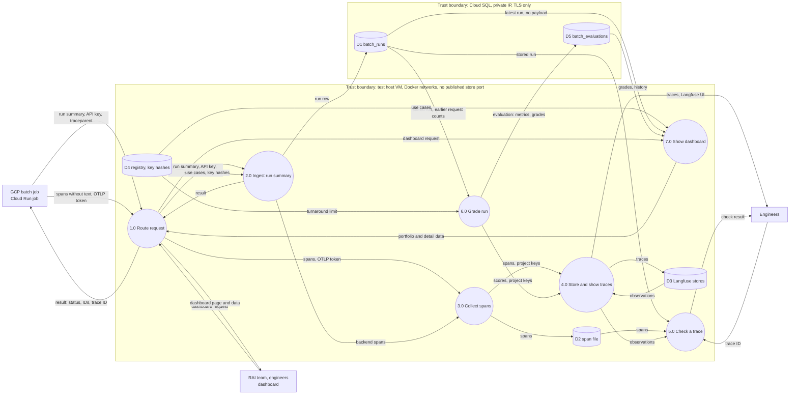

# Data flow, batch-run 0002: the data of one run, with its grade and the dashboard

## What it shows

The data of one batch run on the GCP test host: what leaves the GCP job, which processes
handle it, where it is stored, how it is graded, and what the dashboard reads. It marks
the two trust boundaries: the test host VM and Cloud SQL.

The picture leaves out control (what starts the worker), the order in time, and the
grading rules (the decision `run-grade`). No record text crosses a boundary in October
(`records: []`), and process 7.0 never reads `payload`.

## What changed since the previous version

| Version 0001 | This version | Source |
|---|---|---|
| — | **6.0 Grade run** (S2-05): reads the stored run and the earlier request counts from D1 and the turnaround limit from D4; writes D5; sends the scores to 4.0 | `backend/app/batch_evaluator.py` |
| — | **D5 batch_evaluations** in the Cloud SQL boundary | `backend/app/db.py` (migration 9) |
| — | **7.0 Show dashboard** (S2-07): reads the use cases (D4), the latest run (D1, no `payload`) and the grades and history (D5) | `backend/app/dashboard_view.py`, `api/dashboard_routes.py` |
| — | External entity **RAI team, engineers**: the dashboard, through 1.0 (front-door port 8082) | `deploy/nginx/conf.d/dashboard.conf` |

Recorded as a Mermaid version: draw.io desktop is not installed on the machine that
recorded it.

## Key

| Mark | Means |
|---|---|
| Circle | A process, numbered |
| Cylinder | A data store, numbered D1 to D5 |
| Box | An external entity |
| Group | A trust boundary |
| Arrow | A data flow, labelled with the data |

## Sources

- `backend/app/api/batch_routes.py`, `dashboard_routes.py`; `backend/app/batch_evaluator.py`,
  `dashboard_view.py`, `db.py`, `registry.py`
- `deploy/compose/otel-collector.yaml`, `deploy/nginx/conf.d/`
- `changes/2026-10-14-s2-05-batch-evaluator/spec.md`, `changes/2026-10-14-s2-07-dashboard/spec.md`
- Version 0001
