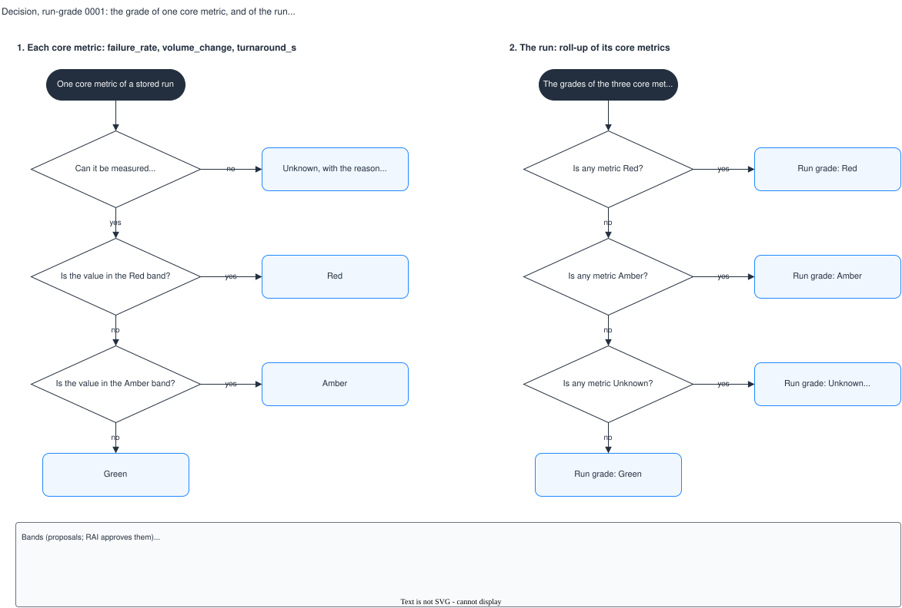

# Decision, run-grade 0001: the grade of one core metric, and of the run

## What it shows

Two decisions. The first gives one core metric (`failure_rate`, `volume_change` or
`turnaround_s`) its grade: Unknown when it cannot be measured, then Red, Amber or Green by
its bands. The second rolls the three metric grades up to the grade of the run: Red first,
then Amber, then Unknown, and Green only when all three are Green. The bands are in the
note; they are proposals until RAI approves them.

The picture leaves out the record metrics and the LLM metrics (Unknown with
`records_not_approved` in October, and not in the roll-up) and the delivery lane.

## What changed since the previous version

First recorded version.

## Key

| Mark | Means |
|---|---|
| Dark rounded box | The case that is decided |
| Diamond | A question |
| Blue box | An outcome |

## Sources

- `changes/2026-10-08-batch-metric-profiles/core-metrics.md`, section 1
- `changes/2026-10-02-batch-monitoring-mvp/issues.md`, S2-05 (the October scope)
- `backend/app/engines/health.py`: `HEALTH_RANK` (Red, Amber, Unknown, Green) and `evaluate` (Red is examined first)
- Not built: there is no batch evaluator and no `batch_evaluations` table yet
