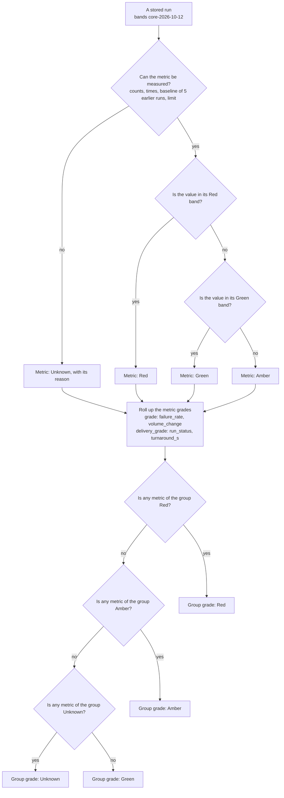

# Decision, run-grade 0002: the grade of one metric, and the two grades of a run, as built

## What it shows

How the batch evaluator grades one stored run in October (identity-only). First, each
core metric gets its grade: Unknown when it cannot be measured, then Red, Green or Amber by
its band. Then the metric grades roll up, worst first (Red, Amber, Unknown, Green), into
two separate grades: `grade` (`failure_rate`, `volume_change`) and `delivery_grade`
(`run_status`, `turnaround_s`). The delivery grade never changes `grade`.

The bands (`core-2026-10-12`, RAI approved):

| Metric | Green | Amber | Red | Unknown when |
|---|---|---|---|---|
| `failure_rate` | < 0.01 | 0.01 to < 0.05 | ≥ 0.05 | no requests (`no_requests`) |
| `volume_change` | 0.7 to 1.3 | 0.4 to < 0.7, or > 1.3 to 2.0 | < 0.4 or > 2.0 | fewer than 5 earlier runs (`no_baseline`) |
| `turnaround_s` | ≤ limit | ≤ 2 × limit | > 2 × limit | no `submitted_at` or no limit (`not_reported`) |
| `run_status` | completed | partial | failed | another status (`invalid_status`) |

`run_status` has no value: its "band" is the status itself. A count or a time that cannot
be read gives Unknown (`invalid_counts`, `invalid_times`). The record metrics
(`valid_output_rate`, `block_rate`) are Unknown with `records_not_approved` and are not in
either roll-up. The picture leaves out the missing-run check (S3-02).

## What changed since the previous version

Version 0001 was a proposal from the metric design. The build (S2-05, #88) differs:

| Version 0001 | This version | Source |
|---|---|---|
| One roll-up of three metrics (`failure_rate`, `volume_change`, `turnaround_s`) to the grade of the run | Two roll-ups: `grade` (`failure_rate`, `volume_change`) and `delivery_grade` (`run_status`, `turnaround_s`) | `backend/app/engines/batch_grading.py` |
| — | `run_status` as a metric (completed, partial, failed): the per-run part of "run on time" | S2-05 decision 2026-10-14 |
| Bands are proposals | Bands approved by RAI, version `core-2026-10-12` | `changes/2026-10-14-s2-05-batch-evaluator/intent.md` |
| Unknown when the metric cannot be measured | Also `invalid_status`, `invalid_counts`, `invalid_times` | `batch_grading.py` |

Recorded as a Mermaid version: draw.io desktop is not installed on the machine that
recorded it.

## Key

| Mark | Means |
|---|---|
| Rectangle at the top | The case that is decided |
| Diamond | A question |
| Rectangle after a branch | An outcome |

## Sources

- `backend/app/engines/batch_grading.py` (`grade_run`, the metric functions, `BANDS_VERSION`)
- `backend/app/engines/health.py` (`worst`, `HEALTH_RANK`)
- `changes/2026-10-14-s2-05-batch-evaluator/intent.md` and `spec.md`
- `changes/2026-10-08-batch-metric-profiles/core-metrics.md`, section 1
- Version 0001
