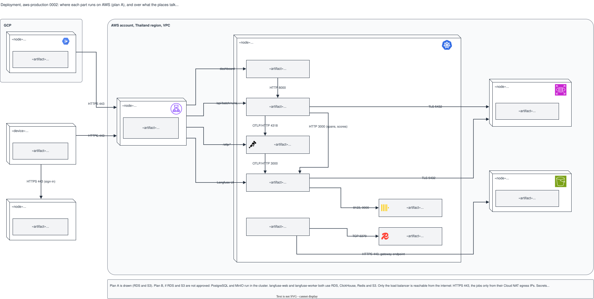

# Deployment, aws-production 0002: the cluster, RDS and S3 (plan A)

## What it shows

Where each part runs on AWS with plan A, and the protocol and port between the places: the
load balancer, the Kubernetes cluster with its services, Amazon RDS, Amazon S3, and the
nodes outside (the Cloud Run job in GCP, a staff laptop, Google Workspace).

The picture leaves out the subnets, the security services and the logging, which the
architecture shows. Plan B and the open decision on the number of RDS instances are in the
note.

## What changed since the previous version

| Version 0001 | This version | Source |
|---|---|---|
| No path from the monitor backend to `langfuse-web` | HTTP 3000, the spans and scores of the backend (Langfuse SDK) | `plan.md`, decision of 2026-10-03; `issues.md` S2-05; architecture 0004 |
| oauth2-proxy to the backend: "HTTP" | HTTP 8000 | `deploy/compose/compose.yaml` (the backend port) |
| Backend to the Collector: "OTLP/HTTP" | OTLP/HTTP 4318 | `deploy/compose/compose.yaml` |

## Key

| Mark | Means |
|---|---|
| Box with a folded edge | A node: a place where software runs |
| Grey box in a node | An artifact: one service or one resource |
| Rounded grey box | An account or a provider |
| Small logo | The product of a node or an artifact; the sources are in `docs/diagram/icons/README.md` |
| Arrow | A communication path, with protocol and port, or the route |

## Sources

- `changes/2026-10-02-batch-monitoring-mvp/issues.md`: S2-05, S3-06, S3-07, S4-01, S4-02, the fixed versions
- `changes/2026-10-02-batch-monitoring-mvp/plan.md`, the decisions of 2026-10-03, 2026-10-04 and 2026-10-05
- `deploy/compose/compose.yaml` (the ports of the backend and the Collector)
- Architecture 0004
