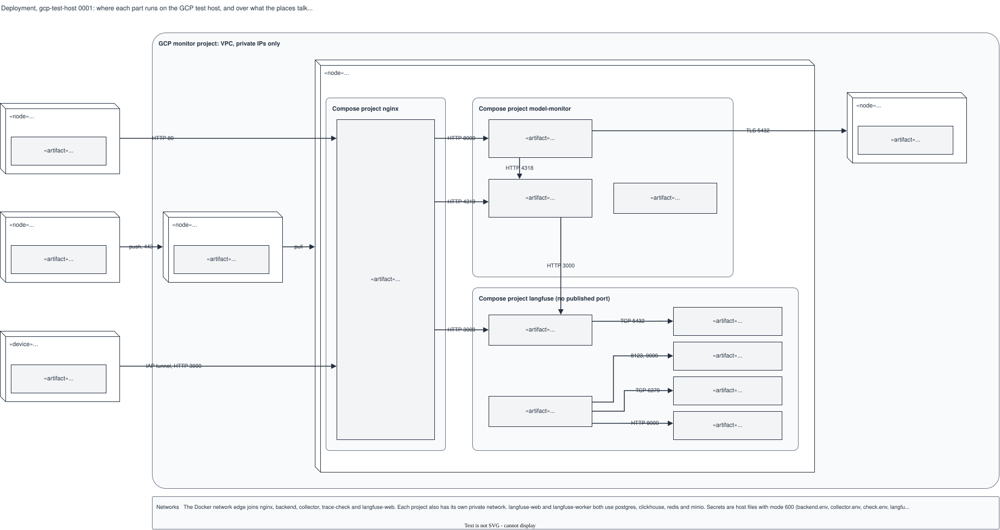

# Deployment, gcp-test-host 0001: the Compose projects on the VM

## What it shows

Where each part runs on the GCP test host, and the protocol and port between the places:
the Compute Engine VM with the Compose projects `nginx`, `model-monitor` and `langfuse`,
the Cloud SQL instance, Artifact Registry, and the nodes outside (the Cloud Run job, GitHub
Actions, an engineer's laptop). Each artifact names its image and its ports and volumes.

The picture leaves out what the components do (the architecture) and the machine size. It
is drawn from the deploy files; the Langfuse project is not yet installed on the VM.

## What changed since the previous version

First recorded version.

## Key

| Mark | Means |
|---|---|
| Box with a folded edge | A node: a place where software runs |
| Grey box in a node | An artifact: one service, with its image |
| Rounded grey box | A network or a Compose project |
| Small logo | The product of a node or an artifact; the sources are in `docs/diagram/icons/README.md` |
| Arrow | A communication path, with protocol and port |

## Sources

- `deploy/compose/compose.yaml`, `compose.testhost.yaml`, `otel-collector.yaml`
- `deploy/nginx/compose.yaml`, `compose.testhost.yaml`, `conf.d/`
- `deploy/langfuse/compose.yaml`, `compose.testhost.yaml`
- `.github/workflows/build-image.yml`
- `changes/2026-10-02-batch-monitoring-mvp/issues.md`, S1-04 (Cloud SQL, IAP)
