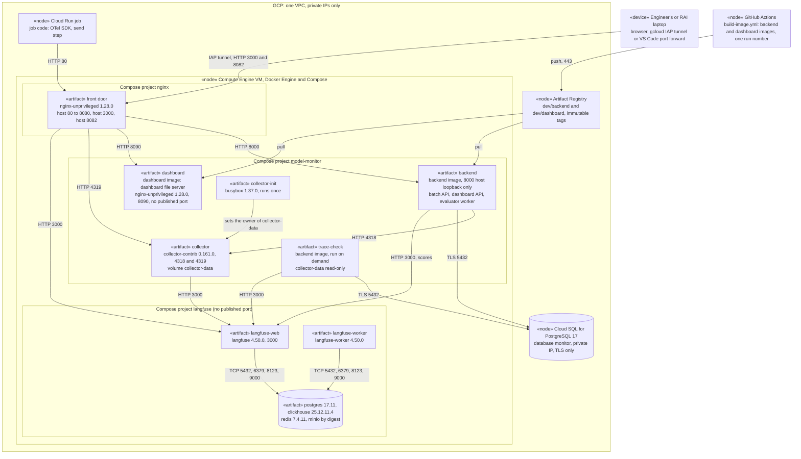

# Deployment, gcp-test-host 0002: the Compose projects on the VM, with the dashboard

## What it shows

Where each part runs on the GCP test host, and the protocol and port between the places:
the Compute Engine VM with the Compose projects `nginx`, `model-monitor` and `langfuse`,
Cloud SQL, Artifact Registry, and the nodes outside (the Cloud Run job, GitHub Actions, a
laptop). Each artifact names its image and its ports.

The picture leaves out what the components do (the architecture), the machine size and
the volumes of Langfuse. It is drawn from the deploy files.

## What changed since the previous version

| Version 0001 | This version | Source |
|---|---|---|
| — | The `dashboard` artifact (S2-07): the dashboard image with the dashboard file server on 8090, no published port | `deploy/compose/compose.yaml`, `deploy/dashboard/` |
| Front door: host 80 and 3000 | Also host **8082** (dashboard); the front door sends `/` to the dashboard and the dashboard API to the backend | `deploy/nginx/compose.testhost.yaml`, `conf.d/dashboard.conf` |
| Artifact Registry: the backend image | The backend and dashboard images, one run number for both | `.github/workflows/build-image.yml` |
| Backend: batch API | Also the dashboard API and the evaluator worker (S2-05) | `backend/app/main.py`, `backend/app/batch_evaluator.py` |
| — | Backend to `langfuse-web` on HTTP 3000: the scores of each graded run (S2-05) | `deploy/compose/add-langfuse-backend-env.sh`, `backend/app/adapters/langfuse_scores.py` |
| Laptop: HTTP 3000 through IAP | HTTP 3000 and 8082 through IAP; also used by the RAI team | `TESTHOST.md`; firewall `langfuse-testhost-allow-iap` (tcp:3000, tcp:8082) |

Recorded as a Mermaid version: draw.io desktop is not installed on the machine that
recorded it. It has no product icons and no image file.

## Key

| Mark | Means |
|---|---|
| Box with `«node»` or `«device»` | A node: a place where software runs |
| Box with `«artifact»` | One service, with its image |
| Rounded group | A network or a Compose project |
| Arrow | A communication path, with protocol and port |

## Sources

- `deploy/compose/compose.yaml`, `compose.testhost.yaml`, `add-langfuse-backend-env.sh`
- `deploy/nginx/compose.yaml`, `compose.testhost.yaml`, `conf.d/` (with `dashboard.conf`)
- `deploy/dashboard/Dockerfile`, `file-server.conf`
- `deploy/langfuse/compose.yaml`
- `.github/workflows/build-image.yml`
- `deploy/compose/TESTHOST.md`, sections "Batch evaluator (S2-05)" and "Dashboard (S2-07)"
- `DEVLOG.md`, 2026-10-14 (S2-05 and S2-07 deployed: `backend:16`, `dashboard:16`)
- Version 0001
