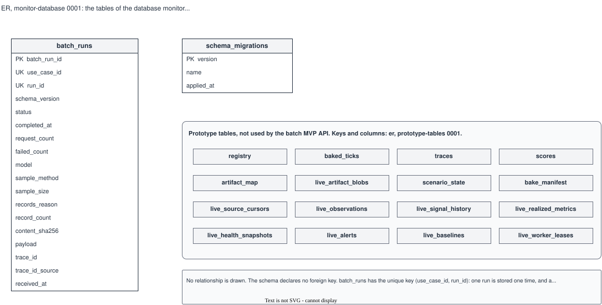

# ER, monitor-database 0001: the tables of the database monitor

## What it shows

The tables that the migrations in `backend/app/db.py` make. `batch_runs` and
`schema_migrations` are the tables of the batch MVP and show every column. The 16 prototype
tables are in the same database; the batch MVP API does not use them, so they are shown by
name only. Their keys and columns are in
[`prototype-tables` 0001](../prototype-tables/0001-live-and-demo-tables.md).

The schema declares no foreign key, so the picture has no relationship line. The Langfuse
database is a different database and is not in this picture.

## What changed since the previous version

First recorded version.

Corrected in place on 2026-10-14 (the schema did not change): the rule asks for every
column of every table, and this picture shows the 16 prototype tables by name only. Their
columns are now in the subject `prototype-tables`, and the box of the prototype tables
here names that subject. `er.md` allows a table of another subject as a header-only box.

## Key

| Mark | Means |
|---|---|
| **PK** | Primary key |
| **UK** | Part of the unique key `uq_batch_run (use_case_id, run_id)` |
| Grey header box | A prototype table, shown by name only; its columns are in `prototype-tables` |

Keys of the prototype tables:

| Table | Primary key | Unique key |
|---|---|---|
| `registry` | `registry_id` | — |
| `baked_ticks` | `(scenario_id, tick)` | — |
| `traces` | `trace_id` | — |
| `scores` | `id` | — |
| `artifact_map` | `artifact_id` | — |
| `live_artifact_blobs` | `artifact_id` | — |
| `scenario_state` | `id` | — |
| `bake_manifest` | `scenario_id` | — |
| `live_source_cursors` | `source_id` | — |
| `live_observations` | `observation_id` | `(source_id, window_id)` |
| `live_signal_history` | `id` | `(observation_id, signal_key)` |
| `live_realized_metrics` | — | `(source_id, tick, metric_key)` |
| `live_health_snapshots` | `source_id` | — |
| `live_alerts` | `alert_id` | — |
| `live_baselines` | — | `(source_id, kind, model_version)` |
| `live_worker_leases` | `lease_name` | — |

## Sources

- `backend/app/db.py`: the table definitions and migrations 1 to 8
- `deploy/sql/s1-11/` (the accounts; not drawn)
