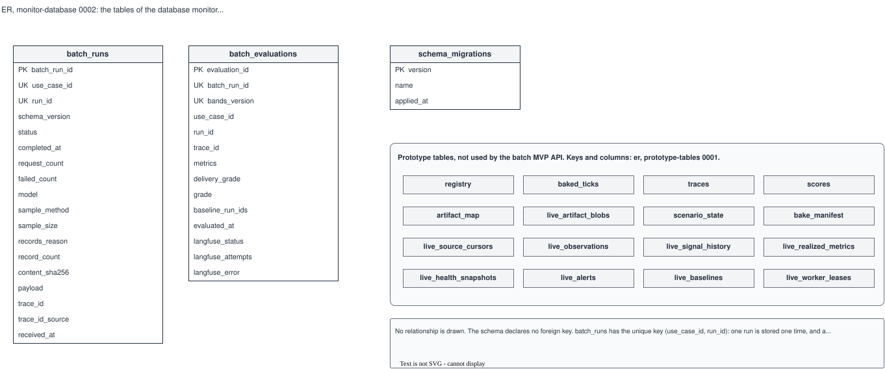

# ER, monitor-database 0002: the tables of the database monitor

## What it shows

The tables that the migrations in `backend/app/db.py` make. `batch_runs`,
`batch_evaluations` and `schema_migrations` are the tables of the batch MVP and show every
column. The 16 prototype tables are in the same database; the batch MVP API does not use
them, so they are shown by name only. Their keys and columns are in
[`prototype-tables` 0001](../prototype-tables/0001-live-and-demo-tables.md).

The schema declares no foreign key, so the picture has no relationship line. The Langfuse
database is a different database and is not in this picture.

## What changed since the previous version

| Change | Source |
|---|---|
| Added `batch_evaluations`: one evaluation of a stored run for each bands version, with the grade fields and the Langfuse delivery fields | Migration 9 (S2-05, #88) |
| Nothing drawn for migration 10: it gives the existing runs uuid7 IDs and changes no column | Migration 10 (S2-05, #88) |

The table is in the repository from #88. On the test host it appears when S2-05 is
deployed; until then the database there has the tables of version 0001.

## Key

| Mark | Means |
|---|---|
| **PK** | Primary key |
| **UK** | Part of a unique key: `uq_batch_run (use_case_id, run_id)` or `uq_batch_evaluation (batch_run_id, bands_version)` |
| Grey header box | A prototype table, shown by name only; its columns are in `prototype-tables` |

## Sources

- `backend/app/db.py`: the table definitions and migrations 1 to 10
- `changes/2026-10-14-s2-05-batch-evaluator/spec.md`
