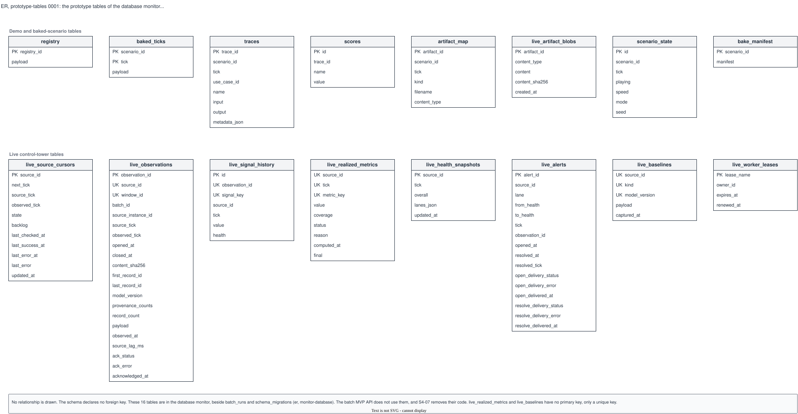

# ER, prototype-tables 0001: the prototype tables of the database monitor

## What it shows

The 16 prototype tables that the migrations in `backend/app/db.py` make in the database
`monitor`, each with its keys and every column: the demo and baked-scenario tables, and the
live control-tower tables. The batch MVP API does not use them, and S4-07 removes their
code. `batch_runs` and `schema_migrations`, in the same database, are in
[`monitor-database`](../monitor-database/README.md), which shows these 16 tables by name
only.

The schema declares no foreign key, so the picture has no relationship line. It leaves out
the data types, the defaults and the indexes.

## What changed since the previous version

First recorded version. The tables are split from `monitor-database` because one picture
of 18 tables is too large to read; `er.md` splits a schema of more than about twelve
tables by subject.

## Key

| Mark | Means |
|---|---|
| **PK** | Part of the primary key |
| **UK** | Part of the unique key (`uq_live_observation_window`, `uq_live_signal_observation`, `uq_live_realized_metric`, `uq_live_baseline`) |
| Grey band label | A group of tables, by the comments in `backend/app/db.py` |

## Sources

- `backend/app/db.py`: the table definitions and migrations 1 to 8 (migration 3 adds
  `live_observations.batch_id`, migration 5 adds `live_realized_metrics.final`)
