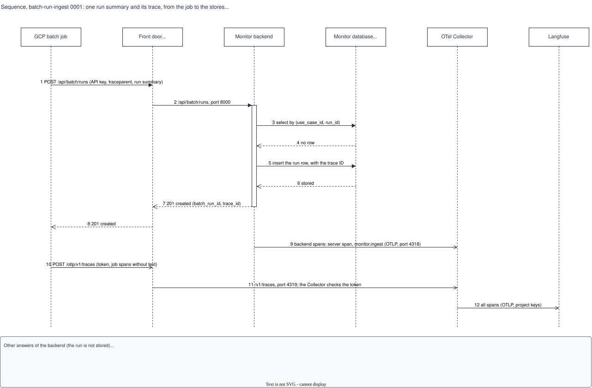

# Sequence, batch-run-ingest 0001: one run summary and its trace

## What it shows

The accepted path of one run: the job sends the run summary through the front door, the
backend stores it one time and answers `201`, and the spans of the job and of the backend
arrive in the Collector and in Langfuse with one trace ID. The note below the picture lists
the other answers of the backend (`401`, `403`, `413`, `400`, `200` duplicate, `409`
conflict).

The picture leaves out the steps inside the backend (key check, registry check, size,
validation), the grading, and the dashboard.

## What changed since the previous version

First recorded version.

Corrected in place on 2026-10-14 (the note only; the code did not change): the front door
refuses a body over 10 MiB itself, with 413, before message 2
(`deploy/nginx/conf.d/model-monitor.conf`, `client_max_body_size 10m`). The backend's own
413 has the same limit, so it is reached only from inside the VM.

## Key

| Mark | Means |
|---|---|
| Solid arrow, filled head | A call that waits for its answer |
| Solid arrow, open head | A send that does not wait (the span exporters) |
| Dashed arrow | An answer |
| Narrow bar on a lifeline | The backend handles the request |

## Sources

- `backend/app/api/batch_routes.py` (the handler and its answers)
- `backend/app/db.py`, `put_batch_run`
- `backend/app/tracing.py`
- `deploy/nginx/conf.d/model-monitor.conf`
- `deploy/compose/compose.yaml`, `deploy/compose/otel-collector.yaml`
- `changes/2026-10-02-batch-monitoring-mvp/issues.md`, S1-05 (the span names of the job)
