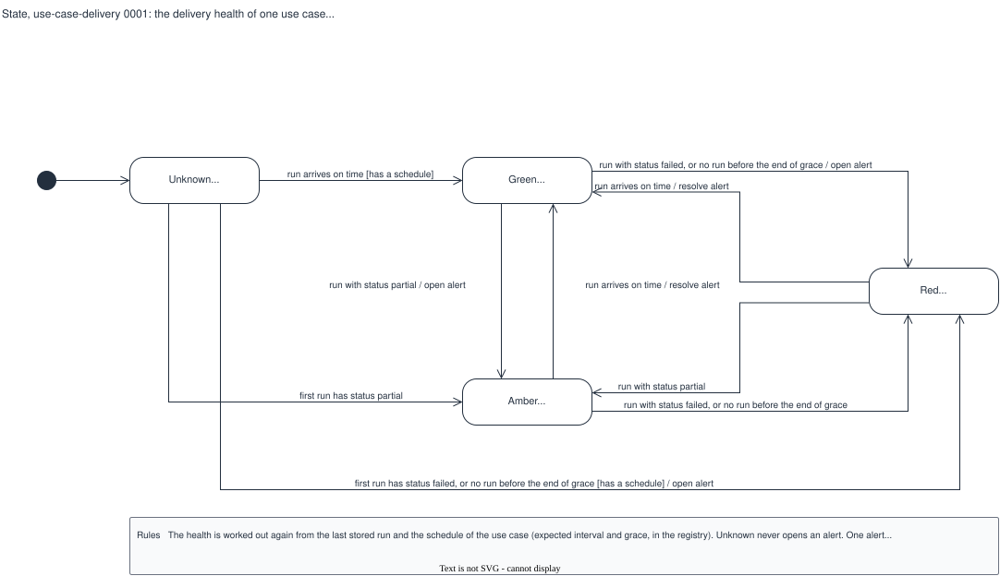

# State, use-case-delivery 0001: the delivery health of one use case

## What it shows

The four values of the delivery health of one use case, and the events that change it: a
run that arrives on time, a run with `status: partial`, a run with `status: failed`, and no
run before the end of the grace period. The labels show when the alert opens and resolves.

The picture leaves out the quality grade (see the decision diagram `run-grade`): the
delivery lane never changes it. A stored run has no states of its own; it never changes.

## What changed since the previous version

First recorded version.

## Key

| Mark | Means |
|---|---|
| Filled circle | The start: a use case with no run yet |
| Rounded box | A state, with its reason codes |
| Arrow | A transition: `event [condition] / action` |

## Sources

- `changes/2026-10-02-batch-monitoring-mvp/issues.md`, S3-02 (the delivery health table and the alert rules)
- `backend/app/registry.py` (the schedule fields that exist today)
- Not built: `backend/app/engines/delivery.py` does not exist yet
