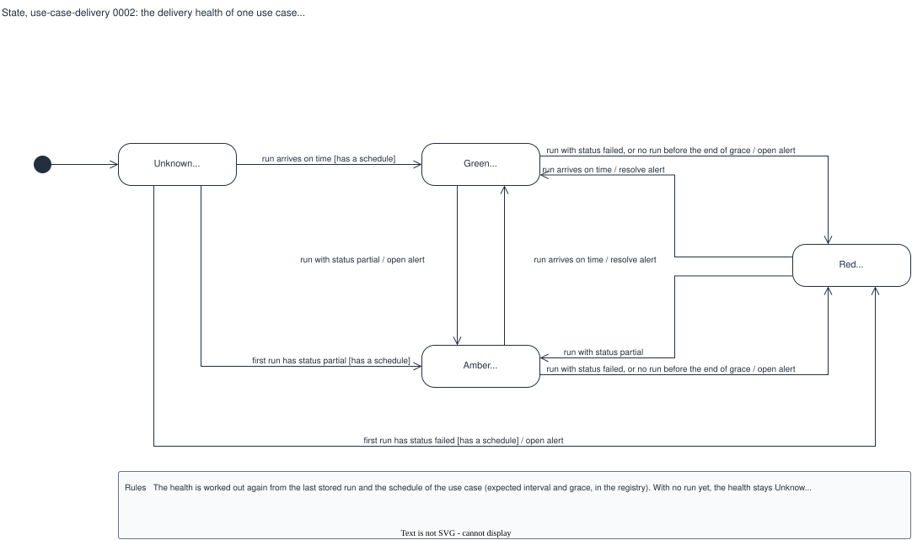

# State, use-case-delivery 0002: the delivery health of one use case

## What it shows

The four values of the delivery health of one use case, and the events that change it: a
run that arrives on time, a run with `status: partial`, a run with `status: failed`, and no
run before the end of the grace period. The labels show when the alert opens and resolves.

The picture leaves out the quality grade (see the decision diagram `run-grade`): the
delivery lane never changes it. A stored run has no states of its own; it never changes.

## What changed since the previous version

Corrected against S3-02, its source:

| Version 0001 | This version | Source |
|---|---|---|
| Unknown to Red also on "no run before the end of grace" | Removed: with no run yet, the health stays Unknown (`no_run_yet`) | `issues.md` S3-02, the table and test "No run yet" |
| Amber to Red with no action | `/ open alert`: the engine opens an alert on every move to Red | S3-02; `backend/app/engines/alerts.py` |
| Unknown to Amber with no condition | `[has a schedule]`, as on the other two moves out of Unknown | S3-02: no schedule gives Unknown |

Two points where S3-02 and the code it reuses disagree are now in the note, to settle
when S3-02 is built:

- S3-02 says the engine keeps one open alert only. The engine keeps one for each health,
  so Amber then Red leaves two open (`backend/app/engines/alerts.py`).
- S3-02 lists `no_schedule`, but the registry requires a schedule
  (`backend/app/registry.py`), so `no_schedule` cannot happen today.

## Key

| Mark | Means |
|---|---|
| Filled circle | The start: a use case with no run yet |
| Rounded box | A state, with its reason codes |
| Arrow | A transition: `event [condition] / action` |

## Sources

- `changes/2026-10-02-batch-monitoring-mvp/issues.md`, S3-02 (the delivery health table, the alert rules and the tests)
- `backend/app/engines/alerts.py` (the transition engine that S3-02 reuses)
- `backend/app/registry.py` (the schedule fields that exist today)
- Not built: `backend/app/engines/delivery.py` does not exist yet
