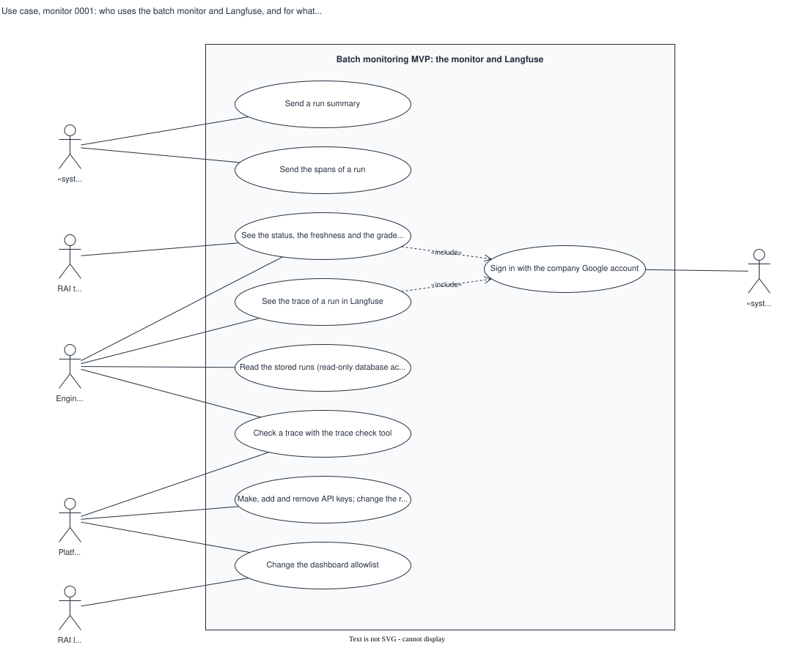

# Use case, monitor 0001: who uses the batch monitor and Langfuse, and for what

## What it shows

The actors outside the batch monitoring MVP and what each can do with it. The GCP batch
job sends a run summary and spans. The RAI team sees the dashboard. Engineers see the
dashboard and Langfuse, read the stored runs and check a trace. Platform manages the keys,
the registry and the allowlist; the RAI lead approves each person on the allowlist. The
dashboard and Langfuse include a sign-in with the company Google account.

The picture leaves out how each use case works and the reviewers of the governance gates,
who do not use the system.

## What changed since the previous version

First recorded version.

## Key

| Mark | Means |
|---|---|
| Box | The system boundary |
| Ellipse | A use case |
| Stick figure | An actor; `«system»` marks a system |
| Dashed arrow `«include»` | The first use case always runs the second |

## Sources

- `changes/2026-10-02-batch-monitoring-mvp/plan.md`: the decisions of 2026-10-03 and 2026-10-05
- `changes/2026-10-02-batch-monitoring-mvp/issues.md`: S3-07 "Who can enter", S1-11, S2-01, S2-03
- `backend/scripts/batch_keys.py`, `backend/scripts/check_trace.py`
- Not built: the dashboard for the GCP use cases (S2-07) and its SSO (S3-07)
