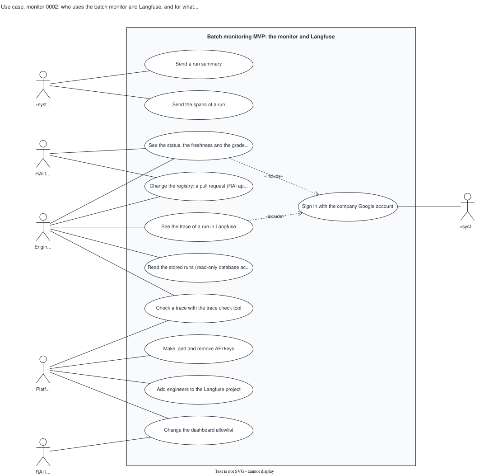

# Use case, monitor 0002: who uses the batch monitor and Langfuse, and for what

## What it shows

The actors outside the batch monitoring MVP and what each can do with it. The GCP batch
job sends a run summary and spans. The RAI team sees the dashboard and approves changes to
the bands. Engineers see the dashboard and Langfuse, read the stored runs, check a trace,
and change the registry by pull request. Platform manages the API keys, the Langfuse
members and the dashboard allowlist; the RAI lead approves each person on the allowlist.
The dashboard and Langfuse include a sign-in with the company Google account.

The picture leaves out how each use case works and the reviewers of the governance gates,
who do not use the system.

## What changed since the previous version

| Version 0001 | This version | Source |
|---|---|---|
| "Make, add and remove API keys; change the registry", Platform only | Two use cases. "Make, add and remove API keys": Platform. "Change the registry: a pull request": Engineers (backend writes and approves it) and the RAI team (approves the bands and the task description). | `backend/registry/batch-use-cases.yaml`; `issues.md` S2-01 |
| — | "Add engineers to the Langfuse project": Platform | `changes/2026-10-12-s2-03-langfuse/plan.md` (step 11); `issues.md` S3-07 "Who can enter" |

The lines from the RAI team and from Engineers cross once: both take part in "See the
status" and "Change the registry".

## Key

| Mark | Means |
|---|---|
| Box | The system boundary |
| Ellipse | A use case |
| Stick figure | An actor; `«system»` marks a system |
| Dashed arrow `«include»` | The first use case always runs the second |

## Sources

- `changes/2026-10-02-batch-monitoring-mvp/plan.md`: the decisions of 2026-10-03 and 2026-10-05
- `changes/2026-10-02-batch-monitoring-mvp/issues.md`: S3-07 "Who can enter", S1-11, S2-01, S2-03
- `changes/2026-10-12-s2-03-langfuse/plan.md`
- `backend/registry/batch-use-cases.yaml`, `backend/scripts/batch_keys.py`, `backend/scripts/check_trace.py`
- Not built: the dashboard for the GCP use cases (S2-07) and its SSO (S3-07)
