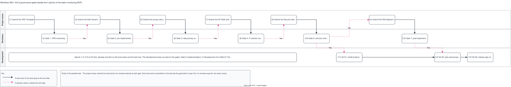

# Workflow 0001: the 8 governance gates beside the 4 sprints

## What it shows

The AI governance document track of the batch monitoring MVP, as the plan has it: the
project owner submits each document, a reviewer decides at each gate, and the development
continues in parallel. The columns are the four sprints. Each gate box names its documents,
its reviewer and its decision date. The pink arrows into the development lane are the hard
stops.

The picture leaves out the "No" loops (the rule is in the note), the content of each
document, and the work inside each sprint.

## What changed since the previous version

First recorded version.

## Key

| Mark | Means |
|---|---|
| Lane | Who does the step |
| Grey bar | A sprint, with its dates |
| Solid dark arrow | The work goes to the next step |
| Dashed pink arrow | A decision starts or allows the next step |

## Sources

- `changes/2026-10-02-batch-monitoring-mvp/issues.md`: "Changes on 2026-10-09: AI governance document track" (the gates, the due dates, the hard stops)
- `changes/2026-10-02-batch-monitoring-mvp/plan.md`: "Sprints at a glance"
